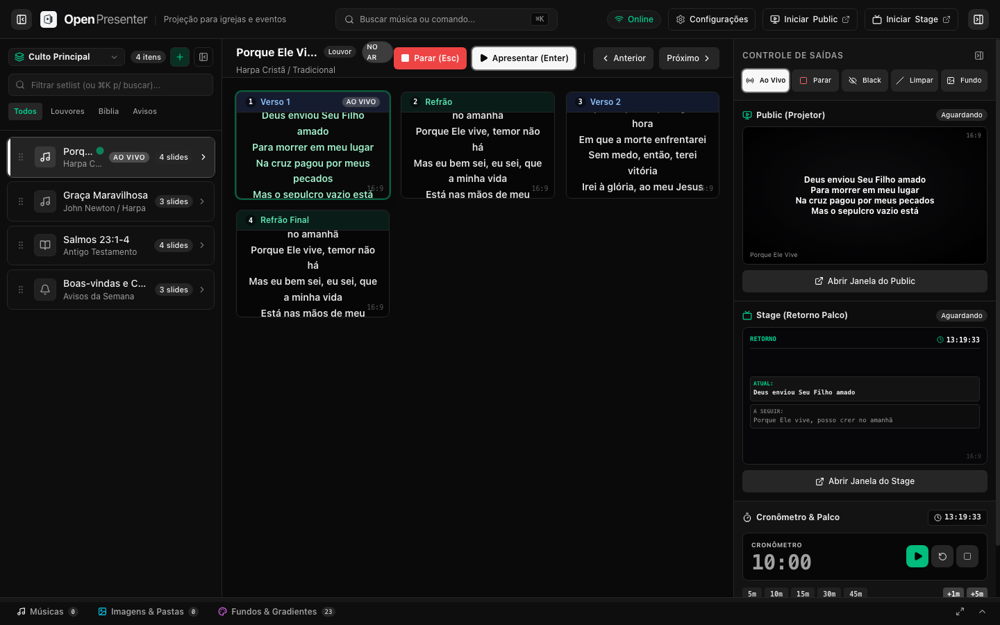
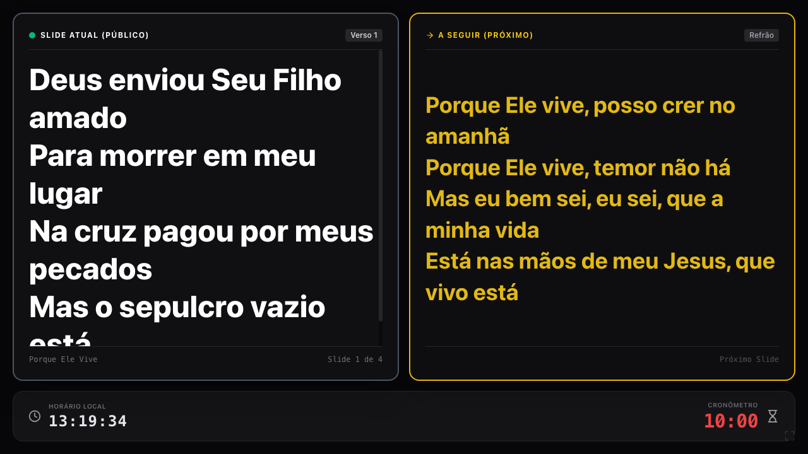

<p align="center">
  <picture>
    <source media="(prefers-color-scheme: dark)" srcset="docs/brand/open-presenter-wordmark-dark.svg" />
    
  </picture>
</p>

<p align="center">
  Software open source para projeção em igrejas e eventos.<br />
  Setlists, louvores, fundos visuais, monitor de palco com 4 presets, timer com overtime e multi-tela via web — 100% offline e local.
</p>

<p align="center">
  <a href="https://github.com/open-mission/openpresenter/releases">
    
  </a>
  <a href="https://github.com/open-mission/openpresenter/blob/main/LICENSE">
    
  </a>
  
  
  
  
  
</p>

<p align="center">
  
</p>

## Por que OpenPresenter?

O **OpenPresenter** foi construído para quem opera projeção em igrejas e eventos ao vivo. Desenvolvido com foco em estabilidade incondicional, latência zero e interface refinada:

- **100% Offline e Local.** Servidor Axum em Rust com banco de dados SQLite local (WAL mode); funciona perfeitamente sem qualquer conexão de internet durante os cultos.
- **Multi-tela via Navegador.** Projeção pública (`/public`) e retorno de palco (`/stage`) acessíveis diretamente por qualquer navegador ou captura de tela no OBS Studio.
- **Fluxo do Operador Pro.** Disparo desacoplado (selecione sem projetar, apresente com `Enter`, pare com `Esc`), atalhos diretos para refrão (`R`), verso (`V`), ponte (`P`) e números ordinais, blackout instantâneo (`.`), limpar texto (`,`) e papel de parede (`/`).
- **Retorno de Palco Avançado.** 4 presets visuais (Split 50/50, Modern Grid, Video Focus e Horizontal Stack), relógio de parede e timer regressivo com alerta no último minuto e modo Overtime ProPresenter em vermelho pulsante.
- **Identidade da Igreja.** Sobreposição configurável da logomarca oficial da sua igreja nos 4 cantos da projeção pública, com ajuste de opacidade e tamanho.
- **Zero-Copy Media.** Mapeie pastas de imagens e vídeos existentes no seu computador através de diálogo nativo do sistema operacional sem duplicar arquivos no disco.

---

## Principais Recursos

### Culto e Setlists

- Criação e gerenciamento de múltiplas Setlists com título e descrição.
- Adição de Louvores, Textos Rápidos, Imagens Avulsas ou Pastas Inteiras de Imagens.
- Reordenação intuitiva de itens por arrastar e soltar (drag & drop).
- Menu de contexto completo: Renomear, Duplicar, Fixar no topo e Remover.
- Definição de papel de parede padrão por setlist, com modos Preencher, Ajustar, Centralizar ou Mosaico.

### Músicas, Letras e Editor Formatado

- Segmentação inteligente de versos no padrão Holyrics (`## Refrão`, `## Verso 1`, etc.).
- Editor de músicas e apresentações rápidas de texto com suporte a formatação rica (negrito, itálico, sublinhado e destaque) e alinhamento horizontal e vertical.
- Busca instantânea no catálogo com SQLite FTS5 (busca full-text sem acentos por título e trechos de versos).
- Gaveta lateral (Sheet) deslizante com visualização da letra completa em 2 colunas antes de projetar.

### Monitor de Retorno do Palco (`/stage`)

Painel completo para cantores, músicos e pregador, com 4 presets configuráveis:

1. **Divisão Equilibrada (50/50):** Caixas de slide atual e próximo lado a lado com molduras estilizadas, etiquetas de seção e rodapé de tempo.
2. **Grid Moderno Pro:** Slide atual em destaque no topo, próximo abaixo e coluna lateral para aviso da equipe técnica, relógio de parede e timer grande.
3. **Foco em Vídeo / Multimídia:** Área ampla central de leitura para projeção e barra inferior minimalista com contadores.
4. **Faixas Horizontais:** Barra superior com relógio/timer, centro em tipografia máxima e próximo slide na base.

Personalização completa de cores para texto do slide atual, próximo slide, bordas, relógio e timer.

<p align="center">
  
</p>

### Tela Pública e Margens de Projeção (`/public`)

- **Preencher Máximo de Espaço:** Amplia a escala tipográfica das letras até o limite da tela para máxima legibilidade no auditório.
- **Controle de Quebra de Linha:** Opção para preservar versos inteiros na mesma linha sem quebra forçada.
- **Metadados do Louvor:** Exibição discreta do título e cantor/compositor no rodapé.
- **Margens de Segurança (Safe Area):** Ajuste fino de margem superior, inferior e laterais para evitar cortes causados por overscan de projetores.
- **Marca da Igreja:** Sobreposição do logo oficial nos cantos Superior Esquerdo, Superior Direito, Inferior Esquerdo ou Inferior Direito.

<p align="center">
  
</p>

### Timer Global e Alertas de Palco

- Motor de contagem regressiva em tempo real com broadcast via WebSocket a cada segundo.
- Alerta visual suave quando restarem menos de 60 segundos.
- **Overtime ProPresenter:** Quando o tempo se esgota, a contagem continua para valores negativos (`-01:30`, `-02:30`) piscando em vermelho vivo pulsante.
- Painel de controle no operador com mostrador digital, controles Play/Pause/Reset/Stop, presets rápidos (`5m`, `10m`, `15m`, `+1m`, `+5m`) e campo para envio de avisos de palco.

### Fundos Dinâmicos, Mesh e Animações CSS

- Nova aba de "Fundos" no painel inferior com navegação em árvore vertical e breadcrumbs.
- Gradientes lineares escuros, Mesh Gradients multicamadas e Animações CSS contínuas (Aurora, Nebulosa, Fluxo Cósmico).
- Aplicação ao vivo no projetor em 1 clique.

### Aparência e Temas Shadcn UI

- Modo Escuro, Claro ou Automático (conforme o sistema operacional).
- Base Colors: **Neutral** (padrão), Slate, Gray, Zinc e Stone.
- Temas de destaque (Theme Accents): Emerald, Blue, Violet, Amber, Rose, etc.

---

## Como Executar Localmente

### Pré-requisitos

- **Rust 1.95+** (`rustup update`)
- **Bun** (ou Node.js 20+)

### 1. Compilar o Frontend

```bash
cd frontend
bun install
bun run build
cd ..
```

### 2. Iniciar o Servidor

```bash
cargo run -p op-admin
```

O OpenPresenter iniciará imediatamente e exibirá as URLs de acesso no terminal:

- **Painel do Operador:** [http://localhost:3000](http://localhost:3000)
- **Tela Pública (Projetor / OBS):** [http://localhost:3000/public](http://localhost:3000/public)
- **Monitor do Palco:** [http://localhost:3000/stage](http://localhost:3000/stage)
- **API Status:** [http://localhost:3000/api/status](http://localhost:3000/api/status)

### Modo de Desenvolvimento (com Hot Reload)

Em um terminal:
```bash
cargo run -p op-admin
```

Em outro terminal:
```bash
cd frontend
bun run dev
```

O Vite servirá o frontend na porta 5173 com proxy automático para a API e WebSocket do Rust na porta 3000.

---

## Portões de Qualidade

Antes de qualquer commit ou release, execute a suíte de validação:

```bash
cargo fmt --all -- --check
cargo clippy --workspace --all-targets -- -D warnings
cargo test --workspace
cd frontend && bun run check && bun run build
```

---

## Dados e Diretórios

Os dados do usuário (banco de dados SQLite, logotipos da igreja e papéis de parede) são armazenados na pasta padrão do sistema operacional:

- **macOS:** `~/Library/Application Support/OpenPresenter`
- **Linux:** `~/.local/share/OpenPresenter`
- **Windows:** `%LOCALAPPDATA%\OpenPresenter`

Para executar em um diretório temporário isolado:

```bash
OPENPRESENTER_DATA_DIR=/tmp/openpresenter-dev cargo run -p op-admin
```

---

## Estrutura do Workspace

```text
crates/
├── op-core/    # Domínio puro: modelos de mídia, slides, timer, setlists, tema e mensagens WsMessage
├── op-db/      # Persistência SQLite: PRAGMAs, migrações numeradas (v1 a v6), FTS5 e app_settings
└── op-admin/   # Servidor Axum: WebSocket (/ws), APIs REST, timer loop e arquivos estáticos
frontend/       # Interface SPA em Svelte 5 + TypeScript + Vite + Tailwind CSS + Shadcn
docs/           # Documentação, especificações (specs), planos de implementação e ADRs
```

Direção de dependências: `frontend` → `op-admin` → `op-db` → `op-core`.

---

## Licença

Distribuído sob a licença [GPL-3.0](LICENSE). Código aberto, livre para uso, estudo e modificação por qualquer igreja, ministério ou desenvolvedor.

---

## Open Mission

O **OpenPresenter** é parte da [Open Mission](https://github.com/open-mission) — tecnologia aberta e de alta qualidade para o Reino de Deus.
