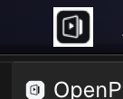
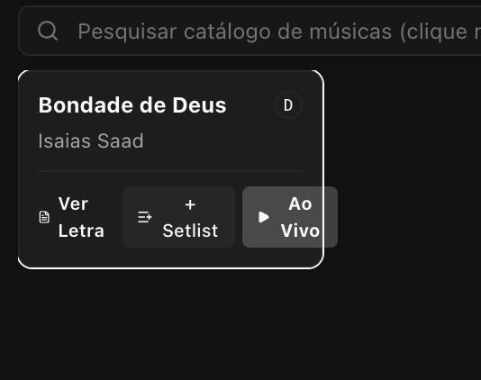

# TO-DO

## Coisas pendentes que foi encontrada para melhorar ou corrigir

## Backlog

## Doing

## Done (com o commit e data e hora de conclusão)

- [x] Feat: Nova aba "Outros" no painel de mídias (BottomPanel.svelte) para visualização, prévia 16:9, busca e gerenciamento de itens de Agenda (Schedule), Textos Livres, Avisos e Seções, com ações de adicionar à setlist, apresentação direta ao vivo e criação/edição. (commit 866050c - 2026-11-01 00:20:00 -03:00)

- [x] Feat/Improve: Customizações visuais e dimensionamento da Agenda (Schedule) nas telas Pública e Palco: opções nas configurações para controle do container (fundo com/sem blur, opacidade e largura máxima), tamanho dos textos (título, dia, horário, detalhes) e ajustes de tamanho dos textos de retorno no monitor de palco. (commit 11b7517 - 2026-10-31 23:51:26 -03:00)

- [x] Lançamento da versão 0.4.0: unificação de versão em todo o workspace (Cargo.toml, package.json, workflows, componentes e testes), consolidação de tipo de mídia agenda, imagens no lower third para OBS, instalação oficial da Harpa Cristã (540 hinos), toasts Sonner, fechamento da release 0.4.0 no CHANGELOG.md, spec docs/specs/2026-10-31-release-0-4-0.md e publicação da tag v0.4.0. (commit ec833fe - 2026-10-31 21:15:22 -03:00)

- [x] Feat/Improve: Exibição e seleção de imagens no Lower Third (`/lower-third`): correção da renderização de imagem (em vez de texto bruto de caminho), opções configuráveis de modo de imagem (`fullscreen`, `lower_third`, `hide`) e ajuste (`contain`/`cover`), e suporte à seleção de imagem alternativa dedicada para o Lower Third em `MediaItem`. (commit e737f28 - 2026-10-31 20:35:23 -03:00)

- [x] Feat: Tipo de Mídia Agenda (Schedule) para cadastro de programações de cultos semanais e festividades/eventos futuros: enum `MediaKind::Schedule` no `op-core`, editor dinâmico `ScheduleEditorModal.svelte` com atalhos de dias da semana, integração na setlist e menu de contexto em `AdminView.svelte`, renderização na Tela Pública (`/public`) com badges de dia/horário e autoScale sobre o papel de parede, e sincronização sequencial no Monitor de Palco (`/stage`) e preview (`StagePreviewBox.svelte`) exibindo dia atual e próximo da agenda. (2026-10-31 13:55:00 -03:00)

- [x] Fix/Improve: Resiliência e diagnóstico do Google Cast Sender SDK: injeção de script e callback estáticos no `index.html`, diagnóstico inteligente de Contexto Seguro (LAN IP vs localhost) e navegadores em `cast.ts`, e atalhos rápidos de abertura de aba no banner de aviso em `CastControl.svelte`. (commit fd5510a - 2026-10-31 13:37:19 -03:00)

- [x] Improve: Rótulos flutuantes em absolute para "Slide Atual" e "A Seguir" no StageView (`/stage`), eliminando o consumo vertical de barras rígidas de cabeçalho e liberando 100% da área útil para o autoScale de letras e versículos bíblicos. (commit b75cbbc - 2026-10-31 13:25:33 -03:00)

- [x] Feat/Improve: Aumento das fontes no monitor de palco (`/stage`) para relógio, timer e aviso, controles de tamanho de fonte nas configurações e alerta de palco em tela cheia temporária (flash pop-in com duração configurável e recolhimento para miniatura). (commit 36169a6 - 2026-10-31 13:19:07 -03:00)

- [x] Improve: Simplificação e agrupamento das saídas no cabeçalho do operador (`AdminView.svelte`): criação do menu dropdown "Saídas" reunindo telas de projeção locais (Pública, Palco, OBS) e conexões sem fio/compartilhamento (Google Cast, Remoto Mobile, QR Codes de rede), reduzindo o cabeçalho a um conjunto limpo e minimalista (Online, Saídas, Configurações) com indicador de conexão Cast. (commit 2c69ca1 - 2026-10-31 13:02:45 -03:00)

- [x] Fix: Corrigir carregamento de imagens e vídeos de fundo no Google Cast (Web Receiver): função canônica `resolveMediaUrl(url)` garantindo URLs absolutas para ``, `<video>` e `background-image: url(...)` no `PublicView.svelte`, `PublicPreviewBox.svelte` e `backgrounds.ts`, suporte a parsing de extensão limpa sem query strings em vídeos/imagens, normalização de referências `url(...)` em estilos CSS via `resolveCssUrls()`, e resiliência com polling assíncrono e expiração de falha no carregamento do SDK do Cast (`cast.ts`). (commit 6f0fa7a - 2026-10-31 12:46:41 -03:00)

- [x] Feat/Improve: Expor e detectar IP na rede local (LAN) para servidor Axum e Vite: exibição clara das URLs locais e da rede no banner do terminal (`main.rs`), suporte à variável `HOST`, resolução multi-alvo em `get_local_ip()` para redes de igreja offline (`routes.rs`), configuração `server.host: true` e proxy `/media` em `vite.config.ts`, e dinamização da URL nos componentes do frontend. (commit 9014fa2 - 2026-10-31 12:29:47 -03:00)

- [x] Fix: Correção de estilização e mídia no Google Cast (Web Receiver) do OpenPresenter: headers explícitos de CORS irrestritos para arquivos estáticos (`/assets/*`), mídias locais (`/media/*`) e SPA fallback no backend Axum (`crates/op-admin`), normalização de caminhos absolutos de mídia e background no `cast.ts` e `PublicView.svelte`, tag `<base href="/">` e estilos críticos inline no container raiz de `PublicView.svelte` e `index.html`. (commit 21be317 - 2026-10-31 12:22:16 -03:00)

- [x] Feat: Importação de músicas via JSON, Texto (.txt) e Markdown (.md), instalação oficial da Harpa Cristã (540 hinos), metadados de tags/grupos com filtragem relacional e padrão configurável de 2 linhas por slide (`op-core`, `op-db`, `op-admin`, `frontend`): migração SQLite `0009_song_tags.sql` para tags associadas com chave composta, rotas `/api/songs/import`, `/api/songs/harpa/install` e `/api/songs/tags`, empacotamento offline de `assets/songs/harpa-crista.json` com fallback para download resiliente via GitHub raw, chunker de estrofes `format_lyrics_lines_per_slide` aplicado automaticamente em importações e buscas online da web (Holyrics/Vagalume), botão de ação rápida "2 Linhas/Slide" no `SongEditorModal`, barra de chips de tags e botão de importação no `BottomPanel`, e aba dedicada "Músicas & Harpa" no `SettingsModal` para instalação e personalização de linhas por slide. (commit 068b055 - 2026-10-31 11:11:47 -03:00)

- [x] Fix: Ajuste da pesquisa de músicas na web via Command Palette (`CommandPalette.svelte`): substituição do botão rotativo cíclico por controle segmentado com botões diretos de modo (`[🎵 Músicas]`, `[📖 Bíblia]`, `[🌐 Web]`), centralização da troca com `switchTab`, controle de cancelamento de buscas assíncronas com `AbortController` e identificador sequencial `searchId`, eliminação de corridas com o debounce reativo, pré-seleção automática da Ação 2 ("Buscar na internet") ao digitar título inédito no catálogo local e preservação do foco no campo de texto. (commit 24a830f - 2026-10-31 10:28:07 -03:00)

- [x] Fix/Improve: Separação correta de slides e redimensionamento com Resizable Shadcn no catálogo de músicas (`BottomPanel.svelte`): decomposição fidedigna das letras de músicas com `parseRawLyrics(song.lyrics_raw)` gerando slides 16:9 individuais para cada estrofe delimitada por quebras duplas `\n\n`, grade flexível de pré-visualização responsiva com wrap em múltiplas colunas (`grid-cols-1 sm:grid-cols-2 xl:grid-cols-3 2xl:grid-cols-4 gap-3`), e integração dos componentes nativos `ResizablePaneGroup`, `ResizablePane` e `ResizableHandle` para ajuste horizontal ergonômico entre catálogo e slides. (commit 055a4e2 - 2026-10-31 10:18:11 -03:00)

- [x] Fix/Improve: Ajuste visual e espaçamento do resizer do painel de mídias (`BottomPanel.svelte`): posicionamento do separador no fluxo natural com margem inferior para não sobrepor os botões de abas, harmonização da cor de fundo com o painel (`bg-card`), indicador de arraste (*drag indicator*) em tom neutro contrastante (`bg-neutral-400 dark:bg-neutral-500`) com realce na cor primária ao interagir e ajuste da altura colapsada. (commit 10e9974 - 2026-10-31 10:02:44 -03:00)

- [x] Improve: Importação de múltiplas versões da Bíblia simultaneamente ("um a um") no modal de configurações: seleção múltipla no diálogo nativo (`multiple` com extensões `.sqlite`, `.db` e `.sqlite3`), fila assíncrona sequencial, barra de progresso visual em tempo real, notificações toast Sonner para cada versão concluída, suporte a múltiplos caminhos na importação manual e contador atômico sequencial no gerador de ID da versão (`BIBLE_IMPORT_COUNTER`) no backend `op-admin`. (commit 35034aa - 2026-10-31 09:18:21 -03:00)

- [x] Improve: Destaque visual com fundo vermelho no botão de parar apresentação no Header do Remote (`/remote`): aplicação de estilo de ação de parada com fundo `bg-red-600 hover:bg-red-500`, ícone preenchido e rótulo adaptativo para facilitar a interrupção imediata da projeção em smartphones e tablets. (commit 3cda7f5 - 2026-10-31 09:11:47 -03:00)

- [x] Improve: Layout de 3 linhas no Stage (aviso, clock e timer embaixo do Próximo Slide) aproveitando melhor o espaço horizontal da tela para letras e versículos, seletor de layout (3 linhas empilhadas vs coluna lateral), recálculo proporcional automático dos sliders de altura mantendo soma exata de 100% e paridade visual no preview do operador (`StagePreviewBox.svelte`). (commit 983d3fd - 2026-10-31 09:08:50 -03:00)

- [x] Improve/fix: Redimensionamento fluido e sem delay do painel inferior de mídias (`BottomPanel.svelte`) com desativação de transição CSS durante o arrasto, captura global de cursor, prevenção de seleção acidental, grip visual no divisor e integração dos componentes nativos `Resizable` do shadcn-svelte (`ResizablePaneGroup`, `ResizablePane`, `ResizableHandle`) baseados em `paneforge`. (commit cb707a3 - 2026-10-31 08:59:33 -03:00)

- [x] Improve: Aumento automático da altura do painel inferior para 75% da janela útil (`window.innerHeight * 0.75`) ao selecionar ou abrir a aba de Bíblia colapsada ou com altura reduzida, garantindo ampla área de leitura para livros, capítulos e versículos com preservação de redimensionamento manual pelo operador. (commit 3c23aa2 - 2026-10-31 08:54:36 -03:00)

- [x] Feat: Suporte a notificações toast com Sonner (`svelte-sonner`) para feedback em tempo real no AdminView (desktop) e RemoteView (mobile) alertando quando apresentações são iniciadas/paradas, novas músicas salvas/editadas no catálogo, modos de exibição alternados e novos aparelhos conectados na rede, preservando telas de projeção (`/public`, `/stage` e `/lower-third`) 100% limpas. (commit 8eef399 - 2026-10-31 08:49:13 -03:00)

- [x] Improve: Opção de reiniciar a aplicação ou o servidor ao ser atualizado e no system tray menu: implementação de `restart_application()` multiplataforma com spawn desanexado, item "Reiniciar OpenPresenter" no System Tray (`TrayMenuIds::restart`), rotas `POST /api/system/restart` e `POST /api/updater/restart`, botão de ação "Reiniciar Aplicativo Agora" em `SettingsModal.svelte` ao atingir o estado `ReadyToRestart` e cartão de reinício na aba Sobre com feedback de progresso e reload automático. (commit a8a9619 - 2026-10-31 08:43:02 -03:00)

- [x] Feat &amp; Improve: Sistema de logs para manter salvas as ações do programa com identificação de instâncias e exibição de navegador/aparelho no dropdown Online do Header: criação da tabela SQLite action_logs (migração 0008), identificadores únicos persistentes de instância (instance_id) e device_info, endpoints /api/logs e /api/logs/clear com filtros por categoria, sincronização em tempo real via WsMessage::ActionLogged, aba dedicada de Histórico e Logs de Auditoria no SettingsModal e dropdown aprimorado de conexões ativas exibindo ícones de computador/smartphone/tablet, navegador/sistema, IP e rota. (commit b1025e1 - 2026-10-31 08:34:16 -03:00)

- [x] Fix: Sentido e sincronização de navegação de slides via teclado: cálculo de `nextSlide()` e `prevSlide()` em `AdminView.svelte` a partir do slide ao vivo em tempo real (`active_slide_index`), inicialização de foco ao disparar versículos bíblicos (`handlePresentScripture`), sincronização bidirecional do operador com outros aparelhos/remoto e auto-scroll do card de slide. (commit b729a8d - 2026-10-31 08:04:39 -03:00)

- [x] Fix: Correção de falso-positivo no destaque verde de versículos na Bíblia em múltiplas instâncias: validação estrita de livro e capítulo em `isScriptureLive` em `BiblePanel.svelte`, impedindo que versículos de mesmo número fiquem verdes em capítulos diferentes (ex: 1Ts 1:7 vs 1Ts 5:7). (commit cc5913a - 2026-10-31 08:00:01 -03:00)

- [x] Lançamento da versão 0.3.1: unificação de versão em todo o workspace (Cargo.toml, package.json, workflows, componentes e testes), consolidação das correções no Lower Third e PWA Remote no iOS, fechamento da release 0.3.1 no CHANGELOG.md, spec docs/specs/2026-10-30-release-0-3-1.md e publicação da tag v0.3.1. (commit 11cf751 - 2026-10-30 18:17:12 -03:00)

- [x] Correções no Lower Third (/lower-third) e suporte a PWA Remote no iOS: resolução resiliente de activeMedia e slides cobrindo músicas da biblioteca/setlist e textos bíblicos com fallback sob demanda; eliminação de tela branca no navegador convencional com introdução de tela de status/boas-vindas para operadores e alternância de simulação de câmera/transparência alfa; classes explícitas is-lower-third no html/body; e criação do manifesto dedicado manifest-remote.webmanifest com start_url: /remote e scope: /remote, alternância dinâmica de manifesto e tags de título do iOS e redirecionamento de PWA mobile standalone da raiz / para /remote. (commit 3fb26f9 - 2026-10-30 18:12:27 -03:00)

- [x] Preparar a versão 0.3.0 para lançamento e ícone oficial no executável: unificação de versão em todo o workspace (Cargo.toml, package.json, workflows, componentes e testes), geração de ícone nativo .icns e PNG 1024x1024 a partir da marca oficial, script de empacotamento macOS (scripts/package-macos.sh) gerando OpenPresenter.app e atribuindo atributos de ícone do Finder ao executável Mach-O, injeção em runtime via Cocoa (Dock/App Switcher), fechamento da release 0.3.0 no CHANGELOG.md e spec docs/specs/2026-10-30-release-0-3-0.md. (commit 4bdf3bb - 2026-10-30 17:29:48 -03:00)

- [x] Correções no Controle Remoto Mobile (/remote): busca bíblica funcional no endpoint /api/bibles/:id/search com suporte a referências rápidas ("Jo 3:16", "Sl 23") via parseBibleReference; divisão estrutural de estrofes de músicas respeitando quebras duplas \\n\\n com parseRawLyrics; navegação contínua de versículos na Bíblia projetando o capítulo com todos os versículos para habilitar botões Anterior/Próximo e contagem correta de slides; e botão de recarregar catálogo de músicas. (commit e61c7db - 2026-10-30 17:03:29 -03:00)

- [x] Refinamento do Controle Remoto Mobile (/remote) e Suporte a PWA: navegação bíblica com sub-abas (Livros em grade, Capítulos em grade touch de 44px, Versículos com leitura integral), Input Group e Drawer Shadcn para seleção de versão bíblica, correção do carregamento da Setlist (/api/setlists/:id), card de controle ao vivo retrátil (collapsible), active states em músicas e versículos projetados ao vivo, safe-area no iOS e Android (top e bottom na navigation bar), header com logotipo oficial do OpenPresenter Minimal, e suporte completo a PWA (manifest.webmanifest, service worker, ícones 192 e 512, favicons e meta tags de app standalone instalável). (commit 8b4d8e6 - 2026-10-30 16:31:19 -03:00)

- [x] Adicionar saída Lower Third transparente (/lower-third) para OBS Studio e transmissão: HTML com fundo transparente (alfa nativo), texto no terço inferior, gradiente/barra customizável, sombras de alto contraste, animações de transição configuráveis (fade, slide, zoom), aba de configurações completa com prévia interativa 16:9, atalho no tray e instruções de Browser Source. (commit fc6a647 - 2026-10-30 15:57:41 -03:00)

- [x] Implementação do Controle Remoto Mobile (/remote) permitindo apresentar setlist, músicas e Bíblia pelo celular: interface mobile-first responsiva com bottom navigation bar em 3 abas, card persistente de controle ao vivo com botões ergonômicos de anterior/próximo para o polegar, ações rápidas de blackout/limpar/parar, busca instantânea, sincronização WebSocket em tempo real, rota no system tray e aba com QR Code no modal de compartilhamento. (commit 52d45eb - 2026-10-30 15:39:03 -03:00)

- [x] Paridade 100% no preview do operador com canvas virtual HD 1080p escalado (idêntico à tela pública real), personalização de posicionamento da referência bíblica (rodapé vs. abaixo do texto) com tamanho de fonte customizável, opções de encaixe do papel de parede (contain, cover, fill) com proteção de margens seguras contra overscan, alinhamento dos switches Tailwind UI e filtro de privacidade na galeria de imagens para proteger arquivos pessoais. (commit 95ee5ca - 2026-10-30 15:01:21 -03:00)

- [x] Separação de configurações dedicadas para letras de louvor e textos bíblicos na Projeção Pública e Monitor de Palco (sub-seções no modal de configurações, alinhamentos, tamanhos de fonte e preenchimento de tela independentes, cores dedicadas no stage) e correção do contraste dos interruptores (switches) de configurações. (commit 0da4508 - 2026-10-30 13:49:51 -03:00)

- [x] Correção de colapso de viewport e auto-scale em receptores Google Cast / Chromecast e Smart TVs HDMI, assegurando dimensões 100% na raiz do DOM e distribuição vertical correta. (commit 5fd74a6 - 2026-10-30 12:59:24 -03:00)

- [x] Integração completa com Google Cast (Chromecast): transmissão sem fio com latência quase zero (&lt;30ms) via Web Receiver Chromium e WebSocket local para Telas Pública (/public) e Monitor de Palco (/stage), modal dedicado de Cast e atalho com status no header do painel. (commit 526a3dc - 2026-10-30 04:39:25 -03:00)

- [x] Especificação técnica, plano de execução e Registro de Decisão Arquitetural (ADR 0013) para suporte a Google Cast com Web Receiver em relação a streams de vídeo HLS. (commit b54a64a - 2026-10-30 04:34:44 -03:00)

- [x] Preparar a versão 0.2.0 para lançamento: unificação de versão (Cargo.toml, package.json, workflows), spec de release e atualização do CHANGELOG.md (2026-10-30 04:25:00 -03:00)

- [x] Auditoria técnica Impeccable no painel do operador: correção de acessibilidade WAI-ARIA, suporte a prefers-reduced-motion, padronização de design tokens semânticos e atualização da skill para v4.8.0. (commit 26dd358 - 2026-10-30 04:13:07 -03:00)

- [x] o icone do trail está estranho  (commit 2cdd5ff - 2026-10-30 02:35:37 -03:00)

- [x] Design Feedback /: Remover badge "X itens" e botão de apagar do cabeçalho da Setlist; exibir dropdown flutuante de conexões WebSocket ativas com IP e rota ao clicar em "Online". (commit 7d3e4fa - 2026-10-30 02:10:22 -03:00)

- [x] Add no command pallete global do app a opcao de pesquisar textos biblico por referencia ou palavras igual acontece no painel da biblias. (commit 6f2498a - 2026-10-30 01:53:27 -03:00)

- [x] Design Feedback /: div "Cronômetro &amp; Palco" - Add a opcao de dar um titulo para o cronometro que irá aparecer no stage. (commit 9044ed4 - 2026-10-30 01:41:35 -03:00)

- [x] Design Feedback /: div "Cronômetro: Cronômetro (Pausado)" no header - Isso aqui só deve aparecer se o timer estiver rodando. (commit 09003ca - 2026-10-30 01:36:35 -03:00)

- [x] Add a opcao de importar fundos de imagens e videos na aba de midias &gt; fundos. (commit a97efc5 - 2026-10-30 01:32:56 -03:00)

- [x] Nos fundos de letras precisamos implementar um sistema que tenhamos um css nas configuracoes para ajustar tanto o fundo como a cor de texto para cada fundo. Isso pode ser util se quisermos entrarmos novos fundos futuramente. (commit d7cb27f - 2026-10-30 01:24:16 -03:00)

- [x] Design Feedback /public: div "📖 João 3:1 ARA ARA" - mover para o rodapé em space-between, remover duplicidade de ARA, remover emoji e tipografia amarela (commit fea7e6a - 2026-10-30 01:05:46 -03:00)

- [x] Quando na aba de musicas o sheet de preview está aberto.  o item de musica fica espremido.  (commit dde80a9 - 2026-10-30 01:00:21 -03:00)

- [x] Na aba de imagens ele nao aceita a sub-pastas. Se eu importo uma pasta ele nao mostra as subpastas e os items. (commit b0ee635 - 2026-10-30 00:56:03 -03:00)

- [x] Na aba de Biblias quando clico duas vezes em um versiculo ele está add no setlist o capitulo. PRecisamos corrigir isso. A ideia é que se eu clicar duas vezes ele apresenta mais nao add no setlist. Se eu clicar com o botao direito mostrar o contexto menu para adicionar no setlist. (commit 852b76d - 2026-10-30 00:44:00 -03:00)

- [x] No setlist Bar quando um item está ao vivo ele tem um indicativo que fica piscando. Vamos remover isso e add a borda verde para quando estamos apresentando um item. (commit ba84d09 - 2026-10-30 00:32:55 -03:00)

- [x] Na Tela Public, add o Auto Scale nas fonts, add a opcao de font-size minimo algo proximo a font-size: 8rem, mas podendo ser ajustado nas configuracoes. Quando a quebra de linha está desatvado está add ... mas a ideia é que reduza o tamanho da fonte para caber. (commit c510264 - 2026-10-30 00:30:14 -03:00)

- [x] Ajustar O stage: Vamos simplificar. A principio vamos manter apenas o preset Grid Moderno Pro. Ajustar o texto para preenhcer o texto fazendo auto-scale para sempre caber no box. Add a opcao de Font-size minimo nas configuracoes. Para ganharmos espaco podemos remover os gaps das boxes e tirar o border-radius. Fazer o Boz de Messagem sempre visivel no Stage. (commit dd36342 - 2026-10-30 00:26:18 -03:00)

- [x] Refinar visual do modo Standby no Stage: cronômetro aparece somente se estiver rodando, remoção do badge superior e do rodapé (commit 7c71974 - 2026-10-29 23:46:05 -03:00)

- [x] Quando eu fecho a aba do painel ele fica abrindo de novo, normalmente se eu já consigo acessar pelo trail, ele nao precisa ficar reabrindo toda hora, abrir automaticamente somente quando abrir a aplicacao. O icone do trail está fundo branco. Ajuste para a versao do icone preto. (commit 6d89743 - 2026-10-29 23:38:48 -03:00)

- [x] Ao acessar [http://localhost:18080/stage](http://localhost:18080/stage) a tela está preta e nao mostra nada, mesmo que no preview pareça mostrar (commit afa1e3c - 2026-10-29 23:14:46 -03:00)

- [x] Ajustar modo compacto de botões (somente ícones) na barra de navegação dos slides e cabeçalho, com suporte a toggle nas configurações de aparência (prints orca-paste) (commit a4f9bbd - 2026-10-29 22:52:19 -03:00)

- [x] Add a descanso mode quando nao tem nada apresentando mostrar o relogio e/ou timer na tela stage. Ele normalmente aparece quando o papel de parede do setlist é ativado. (commit 9a8dc49 - 2026-10-29 22:19:02 -03:00)
- [x] No header do Painel temos o botao para fechar o sidebars porem podemos remove-los pois temos eles nos paines abaixo. Entao fica duplicado. (commit 4af462c - 2026-10-29 22:15:30 -03:00)
- [x] Nas configuracoes temoa a opcao de margem nas definicoes da tela public, porem me parece que nao está funcionando em si, pois nao está aplicando a margem no publico. (commit 02fee4d - 2026-10-29 22:12:23 -03:00)
- [x] Toda vez que uma configuracao for aplicada nao deveria atualizar as telas public e stage? Pois toda vez que tenho que recarregar manualmente, afinal nao temos a opca de recarregar as telas no painel. (commit 18d92fc - 2026-10-29 22:08:52 -03:00)
- [x] Nas configuracoes em Marca da Igreja, temos a opcao de add o logo da igreja, precisamos add a opcao de margem para ajustar melhor a posicao (commit 4c9b712 - 2026-10-29 22:02:13 -03:00)
- [x] No trail criado na aplicacao na maquina nao tem o icone do programa e nem no executavel, ajustar. (commit a75121c - 2026-10-29 21:58:43 -03:00)
- [x] Na secão de previews dos slides pode usar icones apenas para ganhar espço, entao. mas add opcao na configuracoes para exibir labels no botao pode add na aba de aparencia. (commit 6e1a1f6 - 2026-10-29 21:54:23 -03:00)
- [x] No Header remover o texto "Projeção para igrejas e eventos" (commit 80e20ef - 2026-10-29 21:49:56 -03:00)
- [x] Fix: Quando selecionamos o plano de fundo no setlist ele deve ser usado quando nao tem nenhuma apresentacao sendo apresentada, mais quando iniciamos uma apresentacao deve ser substituito o fundo para o padrao selecionado. Entao temos o papel de parede do setlist que normalmente é o tema do culto ou nome do culto, e o background fundo que é apresentado no fundo das letras. E quando cancelamos a apresentacao ele deve voltar ao plano de fundo do setlist. (commit 7c2bc21 - 2026-10-29 21:48:48 -03:00)