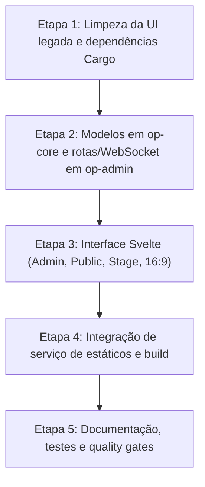

# Plano de Execução — Transição para Arquitetura Web (Rust/Axum + Svelte/shadcn-svelte)

- **Data:** 2026-10-28
- **Spec:** [Spec — Transição para Arquitetura Web](../specs/2026-10-28-arquitetura-web-axum-svelte.md)
- **ADR:** [ADR 0004](../decisions/0004-arquitetura-web-axum-svelte.md)

## Visão Geral das Etapas

## Etapa 1: Limpeza da UI legada e dependências Cargo
- Remover dependências `slint`, `eframe`, `egui`, `display-info` do `Cargo.toml`.
- Adicionar `axum`, `tokio`, `tower-http`, `serde`, `serde_json`, `futures-util`, `tracing`, `tracing-subscriber`.
- Limpar módulos desnecessários de `crates/op-admin`.

## Etapa 2: Modelos em op-core e rotas/WebSocket em op-admin
- Adicionar modelos de domínio em `op-core`: `MediaItem`, `Slide`, `PresentationState`, `OutputDisplayState`, `WsMessage`.
- Implementar em `op-admin`:
  - `state.rs`: gerenciador de estado global thread-safe (`AppState`).
  - `routes.rs`: rotas REST para status, mídias e controle de projeção.
  - `ws.rs`: handler WebSocket para envio de estado inicial e broadcast de eventos.
  - `static_files.rs`: entrega do build do frontend (`frontend/dist`) com fallback.
  - Testes unitários e de integração no backend.

## Etapa 3: Interface Svelte (Admin, Public, Stage, 16:9)
- Implementar componentes no padrão shadcn-svelte em `frontend/src/lib/components/ui/` (Button, Card, Badge, Item/ListItem, ScrollArea).
- Criar cliente WebSocket reativo para sincronização em tempo real.
- Criar tela de Admin em 3 colunas:
  - Sidebar esquerda: itens de mídia com busca.
  - Painel central: visualizador e seletor de slides.
  - Painel direito: Previews do Public e Stage (proporção 16:9), botões de abrir saídas e ações de projeção (Ao Vivo, Blackout, Limpar Texto).
- Criar tela `/public`: projeção limpa em 16:9 para projetores.
- Criar tela `/stage`: tela de retorno com relógio digital, data, slide atual e próximo slide.

## Etapa 4: Integração de serviço de estáticos e build
- Configurar build do frontend (`bun run build`).
- Garantir que o servidor Axum sirva os arquivos de `frontend/dist` para as rotas `/`, `/admin`, `/public`, `/stage`.

## Etapa 5: Documentação, testes e quality gates
- Atualizar `docs/architecture/overview.md` e `docs/README.md`.
- Atualizar `CHANGELOG.md` com a versão 0.3.0.
- Executar `cargo fmt --all`, `cargo clippy --workspace --all-targets -- -D warnings`, `cargo test --workspace`.
- Testar compilação do frontend.
- Realizar commits atômicos e organizados.
