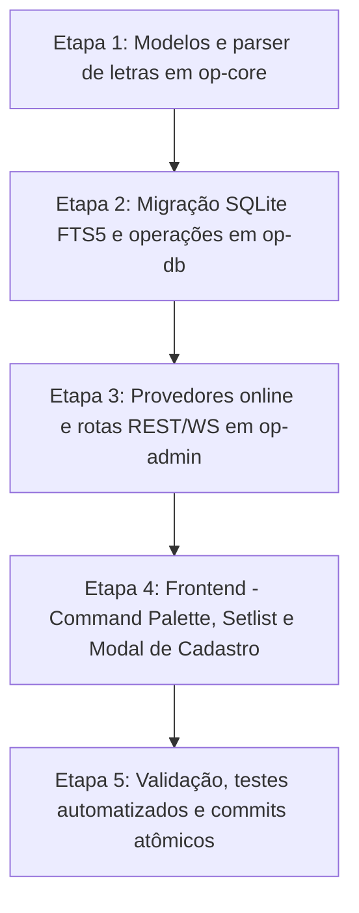

# Plano de Execução — Command Palette, Catálogo com SQLite FTS5 e Cadastro de Músicas

- **Data:** 2026-10-28
- **Spec:** [Spec — Command Palette, Catálogo com SQLite FTS5 e Cadastro de Músicas](../specs/2026-10-28-command-palette-e-cadastro-musicas.md)
- **ADR:** [ADR 0005](../decisions/0005-command-palette-e-catalogo-musicas-fts5.md)

## Visão Geral das Etapas

## Etapa 1: Modelos e parser de letras em `op-core`
- Adicionar `Song`, `SongSection`, `SectionType`, `SongSummary` e `OnlineLyricHit`.
- Adicionar função `parse_song_lyrics(raw_text: &str)` convertendo texto com `## <Rótulo>` e quebras em `Vec<SongSection>` e `Vec<Slide>`.
- Testes unitários para segmentação e identificação de seções.

## Etapa 2: Migração SQLite FTS5 e operações em `op-db`
- Atualizar dependência `rusqlite` para habilitar `bundled-full` no workspace.
- Criar migração `0003_songs_fts.sql`.
- Implementar em `op-db`:
  - `save_song(&self, song: &Song, raw_lyrics: &str)`
  - `get_song(&self, id: &str)`
  - `search_songs(&self, query: &str)` usando MATCH no FTS5 com fallback para LIKE.
  - Testes cobrindo persistência, busca por título e busca por trecho de letra.

## Etapa 3: Provedores online e rotas REST/WS em `op-admin`
- Adicionar dependências `reqwest` com `json`, `flate2` e rotinas criptográficas para Holyrics e Vagalume.
- Criar módulo `online_lyrics.rs` com `search_online` e `fetch_online_song`.
- Adicionar rotas em `routes.rs`:
  - `GET /api/songs`
  - `POST /api/songs`
  - `GET /api/songs/online/search`
  - `GET /api/songs/online/fetch`
  - `POST /api/setlist/add`
- Integrar com `AppState` e emitir eventos WebSocket ao atualizar a Setlist.

## Etapa 4: Frontend - Command Palette, Setlist e Modal de Cadastro
- Renomear Sidebar para "Setlist" e adicionar botão `+`.
- Implementar `CommandPalette.svelte`:
  - Captura global de `⌘K` / `Ctrl+K`.
  - Abas "Banco Local" e "Internet".
  - Ação rápida "Criar nova música manualmente".
  - Atalho `Shift + Enter` para adicionar à Setlist.
- Implementar `SongEditorModal.svelte`:
  - Modal cobrindo 95% da tela.
  - Editor com metadados e letra.
  - Painel de preview 16:9 em tempo real com identificadores de seção.
- Salvar música no banco e adicionar à Setlist.

## Etapa 5: Validação, testes automatizados e commits atômicos
- Executar `cargo fmt --all`, `cargo clippy --workspace --all-targets -- -D warnings`, `cargo test --workspace`.
- Executar `bun run check && bun run build` no frontend.
- Atualizar documentação e changelog.
- Fazer commits atômicos e organizados.
