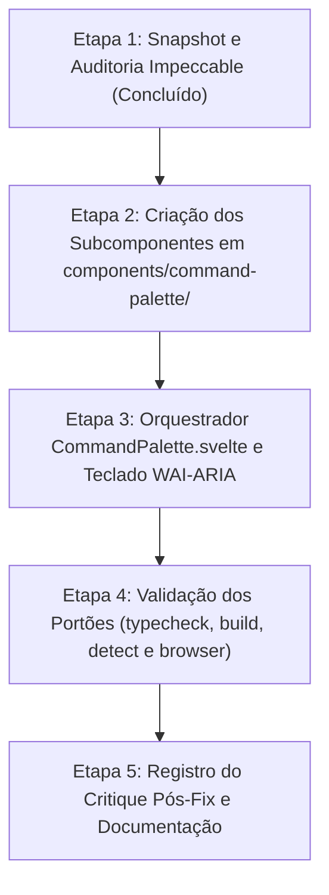

# Plano — Refatoração do Módulo 6 (Command Palette ⌘K)

## Etapas de Execução

## Etapa 1 — Snapshot e Diagnóstico Impeccable (Concluído)
- [x] Rodar `impeccable detect --json` no arquivo atual (`[]`).
- [x] Registrar auditoria pré-fix: **20 / 40** em `.impeccable/critique/2026-11-14T16-23-25Z__frontend-src-lib-components-commandpalette-svelte.md`.
- [x] Criar spec em `docs/specs/2026-11-14-refatoracao-modulo-6-command-palette.md`.

## Etapa 2 — Subcomponentes em `frontend/src/lib/components/command-palette/`
- [x] `CommandPaletteHeader.svelte`: Input semântico com foco automático, ícone de busca, spinner reativo, botão limpar.
- [x] `CommandPaletteTabs.svelte`: Abas `role="tablist"` com navegação por setas/atalhos `Ctrl+1/2/3`, tokens semânticos Light/Dark.
- [x] `LocalSongsResults.svelte`: Itens locais e ações rápidas (criar nova, Harpa) com `role="option"`.
- [x] `BibleSearchResults.svelte`: Seletor de versão com `<select>` acessível, card da passagem e versículos.
- [x] `OnlineLyricsResults.svelte`: Resultados web com loading, `role="alert"` em erros e botão de importação.
- [x] `CommandPaletteShortcuts.svelte`: Rodapé com `<kbd>` sem classes inválidas e texto `>= 11px`.

## Etapa 3 — Orquestrador (`CommandPalette.svelte`)
- [x] Reduzir monólito para ≤ 300 linhas (167 linhas).
- [x] Remover sequestro forçado de `Tab` (permitindo foco sequencial).
- [x] Implementar `AbortController` nas buscas assíncronas de Bíblia e Online.
- [x] Substituir todas as classes `zinc-*` e `bg-black/80` por tokens semânticos (`bg-popover`, `border-border`, etc.).

## Etapa 4 — Portões de Qualidade
- [x] `cd frontend && npm run check` (0 erros).
- [x] `cd frontend && npm run build` (código de saída 0).
- [x] `npx impeccable detect --json` (zerado `[]`).
- [x] Inspeção visual e funcional em `1440×900` e `1024×768` nos temas Claro e Escuro.

## Etapa 5 — Conclusão
- [x] Registrar crítica pós-fix com nota `>= 36/40`.
- [x] Atualizar `CHANGELOG.md` e `docs/README.md`.
