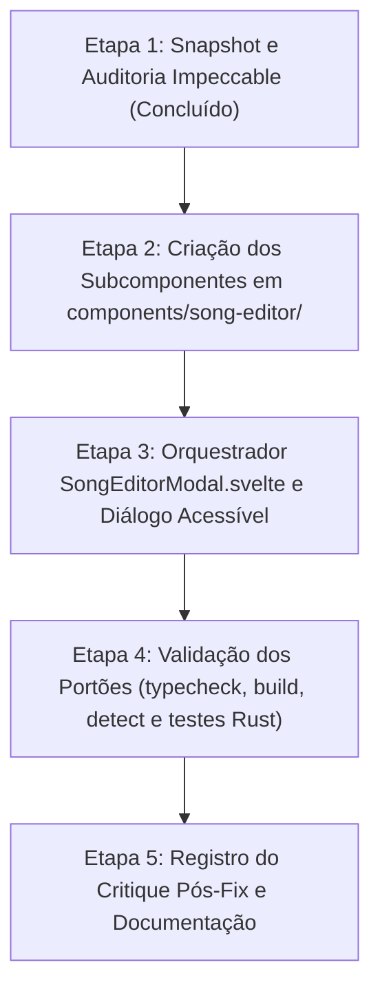

# Plano — Refatoração do Módulo 7 (Editor de Músicas e Repertório)

## Etapas de Execução

## Etapa 1 — Snapshot e Diagnóstico Impeccable (Concluído)
- [x] Rodar `impeccable detect --json` no arquivo atual (`[]`).
- [x] Registrar auditoria pré-fix: **21 / 40** em `.impeccable/critique/2026-11-14T17-41-33Z__frontend-src-lib-components-songeditormodal-svelte.md`.
- [x] Criar spec em `docs/specs/2026-11-14-refatoracao-modulo-7-editor-de-musicas.md`.

## Etapa 2 — Subcomponentes em `frontend/src/lib/components/song-editor/` (Concluído)
- [x] `SongEditorHeader.svelte`: Título, indicador de atalhos (`⌘S`), botões de maximizar e fechar.
- [x] `SongEditorMetadata.svelte`: Título, artista, tom, BPM, tags, áudio playback com pré-escuta e upload.
- [x] `SongEditorToolbar.svelte`: Barra com formatação, inserção de seções (`## Verso`, `## Coro`), alinhamento e quebra em 2 linhas.
- [x] `SongEditorLyrics.svelte`: Textarea principal com estatísticas de linhas/estrofes e atalhos.
- [x] `SongEditorPreview.svelte`: Preview 16:9 de slides sincronizado, badges de seções coloridas.
- [x] `SongEditorConfirmDiscard.svelte`: Diálogo acessível substituindo `confirm()`.

## Etapa 3 — Orquestrador (`SongEditorModal.svelte`) (Concluído)
- [x] Reduzir monólito para ≤ 350 linhas.
- [x] Substituir classes `neutral-*`, `bg-black/80` por tokens semânticos Light/Dark.
- [x] Implementar pilha de `Escape` (confirmação -> modal principal) com retorno de foco.
- [x] Garantir piso tipográfico `>= 11px` e alvos interativos `>= 28×28px`.

## Etapa 4 — Portões de Qualidade (Concluído)
- [x] `cd frontend && npm run check` (0 erros).
- [x] `cd frontend && npm run build` (código de saída 0).
- [x] `npx impeccable detect --json` (zerado `[]`).
- [x] `cargo test -p op-db -p op-admin` (78 testes passando).

## Etapa 5 — Conclusão (Concluído)
- [x] Registrar crítica pós-fix com nota `>= 36/40`.
- [x] Atualizar `CHANGELOG.md` e `TODO.md`.
